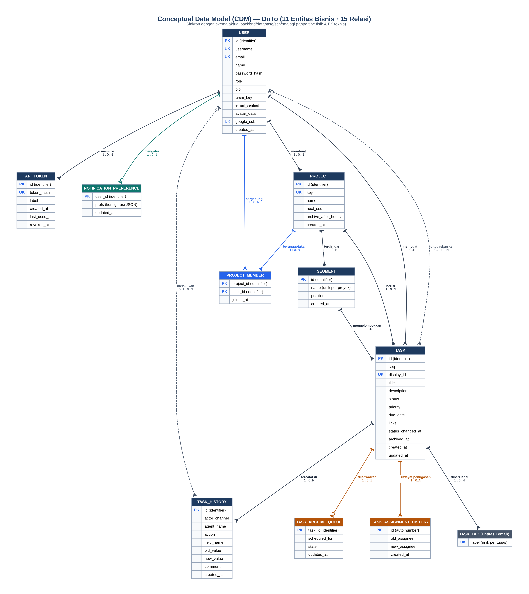
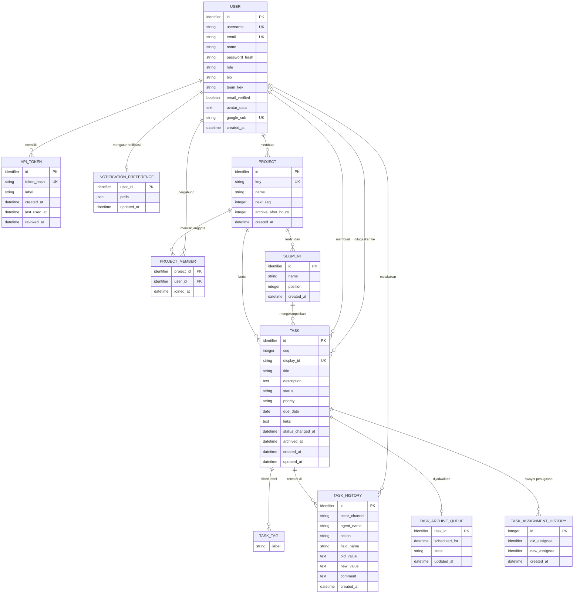
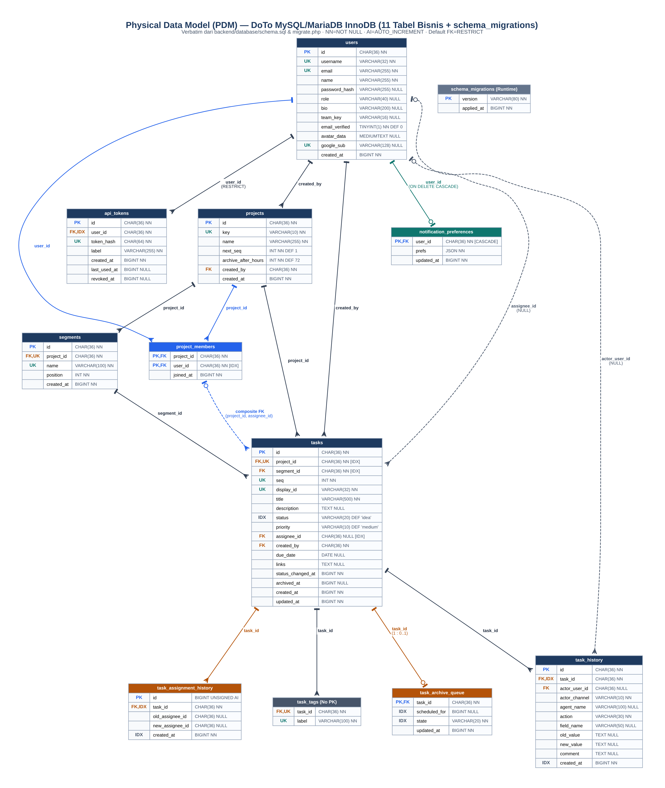
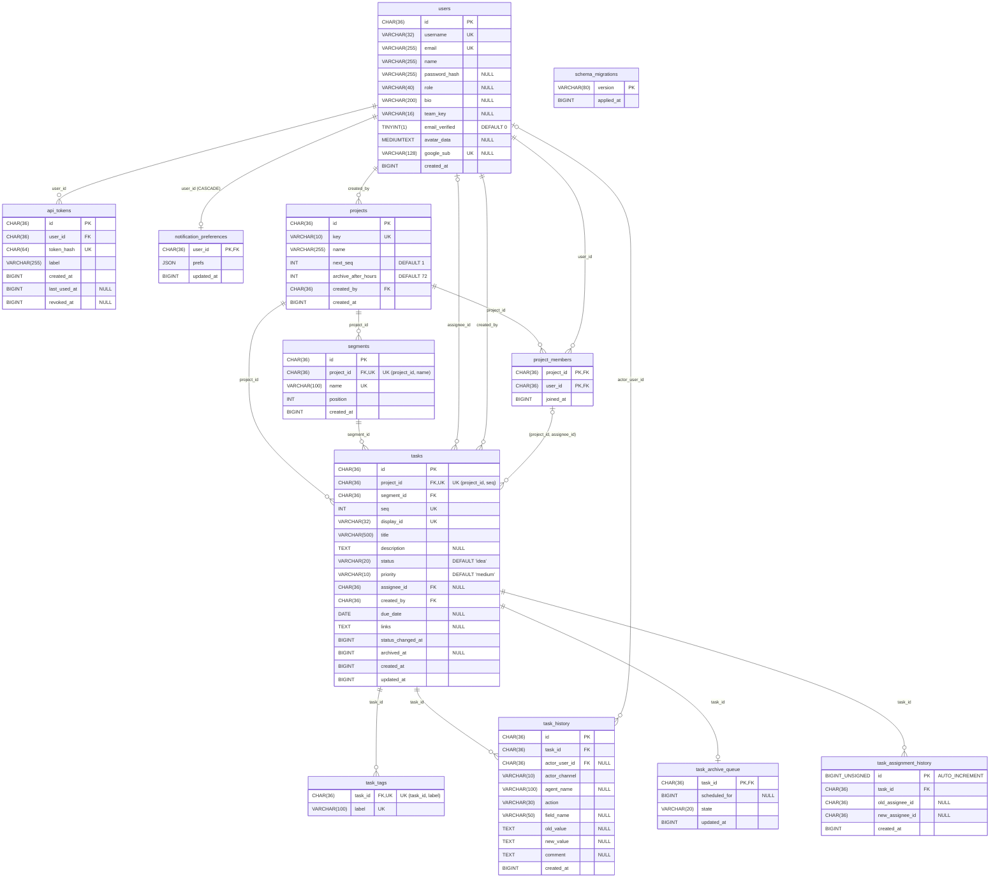

# Desain Database DoTo

Dokumen ini berisi desain data DoTo dalam dua tingkat: **CDM** (Conceptual Data Model) dan **PDM** (Physical Data Model), lengkap dengan kamus data, constraint/index, enum, view, dan trigger. Sumber kebenarannya adalah [`backend/database/schema.sql`](../backend/database/schema.sql), [`backend/database/migrate.php`](../backend/database/migrate.php), [`backend/src/Support/Enums.php`](../backend/src/Support/Enums.php), dan SQL di [`backend/database/triggers/`](../backend/database/triggers/); jika skema berubah, perbarui juga dokumen ini dan gambar di `docs/img/`.

Konvensi umum:

- ID dari aplikasi berupa UUID v4 yang disimpan sebagai `CHAR(36)`; baris audit status yang dibuat langsung oleh trigger memakai `UUID()` dari MySQL/MariaDB.
- Semua timestamp berupa milidetik sejak Unix epoch yang disimpan sebagai `BIGINT`, kecuali `tasks.due_date` bertipe `DATE` (`YYYY-MM-DD`).
- DBMS: MySQL/MariaDB, engine `InnoDB`, charset `utf8mb4`, kolasi `utf8mb4_unicode_ci`.
- Total tabel aktif: **11 tabel bisnis** pada `schema.sql` + **1 tabel metadata migrasi** (`schema_migrations`) yang dibuat otomatis oleh `migrate.php`.
- Versi PostgreSQL (tidak dipakai aplikasi produksi, artefak tugas basis data) ada di [`backend/database/schema-postgres.sql`](../backend/database/schema-postgres.sql).

---

## CDM (Conceptual Data Model)

CDM menggambarkan entitas bisnis, atribut konseptual, dan hubungan antarentitas tanpa detail implementasi fisik DBMS (tanpa foreign key teknis dan tipe data fisik).

### Daftar Entitas CDM (11 Entitas Bisnis)

| No | Entitas | Keterangan |
|---|---|---|
| 1 | `USER` | Pengguna DoTo. Mendukung login kredensial (`username`/`email` + password bcrypt) maupun Google OAuth 2.0 (`google_sub`), profil (`role`, `bio`, `team_key`, `avatar_data`), serta status verifikasi email. |
| 2 | `API_TOKEN` | Token Bearer (`doto_...`, disimpan sebagai hash SHA-256) untuk akses klien CLI dan MCP server. Mendukung soft-revoke (`revoked_at`). |
| 3 | `NOTIFICATION_PREFERENCE` | Preferensi notifikasi per pengguna dalam format JSON terstruktur (5 grup & 20 tombol pengaturan). |
| 4 | `PROJECT` | Proyek tim dengan kode unik (`key`, mis. `K4`, `WEB`), counter penomoran tiket (`next_seq`), dan durasi arsip otomatis (`archive_after_hours`). |
| 5 | `PROJECT_MEMBER` | Entitas asosiatif keanggotaan proyek (M:N antara `USER` dan `PROJECT`) yang memvalidasi siapa saja yang sah menjadi assignee tugas. |
| 6 | `SEGMENT` | Kolom board di dalam proyek dengan nama unik per proyek dan urutan `position`. |
| 7 | `TASK` | Unit tugas dengan ID tampilan `<KEY>-<seq>`, status, prioritas, tenggat (`due_date`), tautan, assignee opsional, serta cap waktu perubahan status dan arsip. |
| 8 | `TASK_TAG` | Entitas lemah label/tag pada tugas (tanpa PK mandiri; unik per pasangan tugas dan label). |
| 9 | `TASK_HISTORY` | Jejak audit perubahan dan komentar pada tugas, termasuk kanal pelaku (`web`, `cli`, `agent`, atau `sql`) dan nama agen AI bila ada. |
| 10 | `TASK_ARCHIVE_QUEUE` | Antrean jadwal pengarsipan otomatis yang dikelola trigger saat tugas masuk/keluar status `done` atau benar-benar diarsipkan. |
| 11 | `TASK_ASSIGNMENT_HISTORY` | Log audit tingkat database khusus perpindahan penanggung jawab (assignee) tugas, termasuk perubahan via SQL langsung. |

### Kardinalitas Relasi CDM (15 Relasi)

| No | Relasi | Kardinalitas | Keterangan |
|---|---|---|---|
| 1 | `USER` memiliki `API_TOKEN` | `1 : 0..N` | Satu pengguna dapat memiliki banyak token CLI/MCP. |
| 2 | `USER` mengatur `NOTIFICATION_PREFERENCE` | `1 : 0..1` | Setiap pengguna memiliki paling banyak satu baris preferensi notifikasi. |
| 3 | `USER` membuat `PROJECT` | `1 : 0..N` | Setiap proyek wajib memiliki satu pembuat (`created_by`). |
| 4 | `PROJECT` memiliki anggota `PROJECT_MEMBER` | `1 : 0..N` | Pembuat proyek otomatis terdaftar sebagai anggota pertama. |
| 5 | `USER` bergabung lewat `PROJECT_MEMBER` | `1 : 0..N` | Satu pengguna dapat tergabung di banyak proyek (termasuk auto-join `K4` saat login Google). |
| 6 | `PROJECT` terdiri dari `SEGMENT` | `1 : 0..N` | Nama segment unik di dalam masing-masing proyek. |
| 7 | `PROJECT` berisi `TASK` | `1 : 0..N` | Setiap tugas terikat ke satu proyek (tidak dapat dipindah proyek). |
| 8 | `SEGMENT` mengelompokkan `TASK` | `1 : 0..N` | Setiap tugas wajib berada pada satu segment milik proyeknya. |
| 9 | `USER` membuat `TASK` | `1 : 0..N` | Pembuat tugas wajib tercatat. |
| 10 | `USER` ditugaskan ke `TASK` | `0..1 : 0..N` | Assignee bersifat opsional (`NULL`), tetapi jika diisi wajib anggota proyek. |
| 11 | `TASK` diberi label `TASK_TAG` | `1 : 0..N` | Label unik per tugas. |
| 12 | `TASK` tercatat di `TASK_HISTORY` | `1 : 0..N` | Setiap pembuatan, perubahan field/status, komentar, dan arsip dicatat. |
| 13 | `USER` melakukan `TASK_HISTORY` | `0..1 : 0..N` | Pelaku bisa `NULL` apabila perubahan status terjadi langsung lewat SQL tanpa variabel sesi. |
| 14 | `TASK` dijadwalkan di `TASK_ARCHIVE_QUEUE` | `1 : 0..1` | Satu tugas memiliki maksimal satu entri jadwal arsip. |
| 15 | `TASK` memiliki `TASK_ASSIGNMENT_HISTORY` | `1 : 0..N` | Mencatat histori perpindahan assignee di tingkat database. |

---

## PDM (Physical Data Model)

PDM menggambarkan tabel fisik sesuai [`backend/database/schema.sql`](../backend/database/schema.sql) dan [`backend/database/migrate.php`](../backend/database/migrate.php), lengkap dengan tipe data MySQL/MariaDB, primary key, foreign key, unique key, dan index.

Kolom tanpa keterangan `NULL` bersifat `NOT NULL`.

---

### Kamus Data Lengkap (Data Dictionary — 12 Tabel)

#### 1. `users`
| Kolom | Tipe Data | Null | Default | Key / Constraint | Keterangan |
|---|---|---|---|---|---|
| `id` | `CHAR(36)` | NOT NULL | - | `PRIMARY KEY` | UUID v4 pengguna |
| `username` | `VARCHAR(32)` | NOT NULL | - | `UNIQUE (users_username_unique)` | Handle unik (`^[a-z0-9._]{3,15}$`) |
| `email` | `VARCHAR(255)` | NOT NULL | - | `UNIQUE (users_email_unique)` | Alamat email unik |
| `name` | `VARCHAR(255)` | NOT NULL | - | - | Nama tampilan pengguna |
| `password_hash` | `VARCHAR(255)` | NULL | `NULL` | - | Hash bcrypt (`NULL` untuk Google-only / `system`) |
| `role` | `VARCHAR(40)` | NULL | `NULL` | - | Peran profil pengguna (teks bebas) |
| `bio` | `VARCHAR(200)` | NULL | `NULL` | - | Bio singkat profil |
| `team_key` | `VARCHAR(16)` | NULL | `NULL` | - | Kode tim default (`'K4'` untuk pengguna baru Google) |
| `email_verified` | `TINYINT(1)` | NOT NULL | `0` | - | Status verifikasi email (`0` belum, `1` terverifikasi) |
| `avatar_data` | `MEDIUMTEXT` | NULL | `NULL` | - | URL atau Data URI avatar (validasi app <= 300 KB) |
| `google_sub` | `VARCHAR(128)` | NULL | `NULL` | `UNIQUE (users_google_sub_unique)` | Subject ID unik dari Google OAuth 2.0 |
| `created_at` | `BIGINT` | NOT NULL | - | - | Waktu pembuatan akun (Unix epoch ms) |

#### 2. `api_tokens`
| Kolom | Tipe Data | Null | Default | Key / Constraint | Keterangan |
|---|---|---|---|---|---|
| `id` | `CHAR(36)` | NOT NULL | - | `PRIMARY KEY` | UUID v4 token |
| `user_id` | `CHAR(36)` | NOT NULL | - | `FK -> users(id)`, `INDEX (api_tokens_user_idx)` | Pemilik token |
| `token_hash` | `CHAR(64)` | NOT NULL | - | `UNIQUE (api_tokens_token_hash_unique)` | Hash SHA-256 hex dari token `doto_...` |
| `label` | `VARCHAR(255)` | NOT NULL | - | - | Nama deskriptif token (mis. `laptop CLI`) |
| `created_at` | `BIGINT` | NOT NULL | - | - | Waktu pembuatan token (epoch ms) |
| `last_used_at` | `BIGINT` | NULL | `NULL` | - | Terakhir dipakai autentikasi Bearer |
| `revoked_at` | `BIGINT` | NULL | `NULL` | - | Waktu pencabutan token (`NULL` = aktif) |

#### 3. `notification_preferences`
| Kolom | Tipe Data | Null | Default | Key / Constraint | Keterangan |
|---|---|---|---|---|---|
| `user_id` | `CHAR(36)` | NOT NULL | - | `PRIMARY KEY`, `FK -> users(id) ON DELETE CASCADE` | Pemilik preferensi (relasi 1 : 0..1) |
| `prefs` | `JSON` | NOT NULL | - | - | Struktur JSON `{ "g": {...5 grup}, "i": {...20 item} }` |
| `updated_at` | `BIGINT` | NOT NULL | - | - | Waktu pembaruan terakhir (epoch ms) |

#### 4. `projects`
| Kolom | Tipe Data | Null | Default | Key / Constraint | Keterangan |
|---|---|---|---|---|---|
| `id` | `CHAR(36)` | NOT NULL | - | `PRIMARY KEY` | UUID v4 proyek |
| `` `key` `` | `VARCHAR(10)` | NOT NULL | - | `UNIQUE (projects_key_unique)` | Kode proyek kapital (`^[A-Z][A-Z0-9]*$`, 2–10 char) |
| `name` | `VARCHAR(255)` | NOT NULL | - | - | Nama proyek |
| `next_seq` | `INT` | NOT NULL | `1` | - | Counter tiket berikutnya (dikunci `FOR UPDATE` oleh trigger) |
| `archive_after_hours` | `INT` | NOT NULL | `72` | - | Jeda jam setelah `done` sebelum diarsipkan otomatis |
| `created_by` | `CHAR(36)` | NOT NULL | - | `FK -> users(id)` | Pembuat proyek (pemilik hak kelola anggota) |
| `created_at` | `BIGINT` | NOT NULL | - | - | Waktu pembuatan proyek (epoch ms) |

#### 5. `project_members`
| Kolom | Tipe Data | Null | Default | Key / Constraint | Keterangan |
|---|---|---|---|---|---|
| `project_id` | `CHAR(36)` | NOT NULL | - | `PK (project_id, user_id)`, `FK -> projects(id)` | Referensi proyek |
| `user_id` | `CHAR(36)` | NOT NULL | - | `PK (project_id, user_id)`, `FK -> users(id)`, `INDEX (project_members_user_idx)` | Referensi pengguna anggota |
| `joined_at` | `BIGINT` | NOT NULL | - | - | Waktu bergabung ke proyek (epoch ms) |

#### 6. `segments`
| Kolom | Tipe Data | Null | Default | Key / Constraint | Keterangan |
|---|---|---|---|---|---|
| `id` | `CHAR(36)` | NOT NULL | - | `PRIMARY KEY` | UUID v4 segment |
| `project_id` | `CHAR(36)` | NOT NULL | - | `FK -> projects(id)`, `UK (project_id, name)` | Proyek induk segment |
| `name` | `VARCHAR(100)` | NOT NULL | - | `UK (project_id, name)` | Nama kolom/kategori pada board |
| `position` | `INT` | NOT NULL | - | - | Urutan tampilan kolom (`MAX(position) + 1`) |
| `created_at` | `BIGINT` | NOT NULL | - | - | Waktu pembuatan segment (epoch ms) |

#### 7. `tasks`
| Kolom | Tipe Data | Null | Default | Key / Constraint | Keterangan |
|---|---|---|---|---|---|
| `id` | `CHAR(36)` | NOT NULL | - | `PRIMARY KEY` | UUID v4 tugas |
| `project_id` | `CHAR(36)` | NOT NULL | - | `FK -> projects(id)`, `UK (project_id, seq)`, `Composite FK -> project_members`, `INDEX` | Proyek induk tugas (denormalisasi terkontrol) |
| `segment_id` | `CHAR(36)` | NOT NULL | - | `FK -> segments(id)`, `INDEX (tasks_board_idx)` | Kolom/segment tugas pada board |
| `seq` | `INT` | NOT NULL | - | `UK (project_id, seq)` | Nomor urut atomik per proyek (diisi trigger) |
| `display_id` | `VARCHAR(32)` | NOT NULL | - | `UNIQUE (tasks_display_id_unique)` | Nomor tiket tampilan `<KEY>-<seq>` (diisi trigger) |
| `title` | `VARCHAR(500)` | NOT NULL | - | - | Judul tugas |
| `description` | `TEXT` | NULL | `NULL` | - | Deskripsi rinci tugas |
| `status` | `VARCHAR(20)` | NOT NULL | `'idea'` | `INDEX (tasks_board_idx)` | Status alur kerja (divalidasi `Enums::TASK_STATUSES`) |
| `priority` | `VARCHAR(10)` | NOT NULL | `'medium'` | - | Prioritas tugas (divalidasi `Enums::TASK_PRIORITIES`) |
| `assignee_id` | `CHAR(36)` | NULL | `NULL` | `FK -> users(id)`, `Composite FK (project_id, assignee_id) -> project_members` | Penanggung jawab tugas (opsional, harus anggota) |
| `created_by` | `CHAR(36)` | NOT NULL | - | `FK -> users(id)` | Pembuat tugas |
| `due_date` | `DATE` | NULL | `NULL` | - | Tanggal tenggat (`YYYY-MM-DD`, default app +14 hari) |
| `links` | `TEXT` | NULL | `NULL` | - | JSON array tautan eksternal `[{"url","label"}]` |
| `status_changed_at` | `BIGINT` | NOT NULL | - | - | Cap waktu terakhir status berubah (acuan arsip) |
| `archived_at` | `BIGINT` | NULL | `NULL` | - | Cap waktu pengarsipan aktual (`NULL` = aktif) |
| `created_at` | `BIGINT` | NOT NULL | - | - | Waktu pembuatan tugas (epoch ms) |
| `updated_at` | `BIGINT` | NOT NULL | - | - | Waktu pembaruan terakhir tugas (epoch ms) |

#### 8. `task_tags` (Entitas Lemah tanpa PK)
| Kolom | Tipe Data | Null | Default | Key / Constraint | Keterangan |
|---|---|---|---|---|---|
| `task_id` | `CHAR(36)` | NOT NULL | - | `FK -> tasks(id)`, `UK (task_id, label)` | Referensi tugas induk |
| `label` | `VARCHAR(100)` | NOT NULL | - | `UK (task_id, label)` | Teks label unik per tugas |

#### 9. `task_history`
| Kolom | Tipe Data | Null | Default | Key / Constraint | Keterangan |
|---|---|---|---|---|---|
| `id` | `CHAR(36)` | NOT NULL | - | `PRIMARY KEY` | UUID v4 (atau `UUID()` dari trigger) |
| `task_id` | `CHAR(36)` | NOT NULL | - | `FK -> tasks(id)`, `INDEX (task_id, created_at)` | Referensi tugas terkait |
| `actor_user_id` | `CHAR(36)` | NULL | `NULL` | `FK -> users(id)` | Pelaku (`NULL` bila update SQL langsung) |
| `actor_channel` | `VARCHAR(10)` | NOT NULL | - | - | Kanal aksi (`web`, `cli`, `agent`, atau `sql`) |
| `agent_name` | `VARCHAR(100)` | NULL | `NULL` | - | Nama agen (`doto-web-ai`, `archive-job`, nama MCP) |
| `action` | `VARCHAR(30)` | NOT NULL | - | - | Jenis aksi audit (lihat tabel Enum) |
| `field_name` | `VARCHAR(50)` | NULL | `NULL` | - | Nama field yang berubah (mis. `status`, `dueDate`) |
| `old_value` | `TEXT` | NULL | `NULL` | - | Nilai sebelum perubahan |
| `new_value` | `TEXT` | NULL | `NULL` | - | Nilai sesudah perubahan |
| `comment` | `TEXT` | NULL | `NULL` | - | Isi komentar (khusus `action = 'comment'`) |
| `created_at` | `BIGINT` | NOT NULL | - | `INDEX (task_id, created_at)` | Waktu kejadian audit (epoch ms) |

#### 10. `task_archive_queue`
| Kolom | Tipe Data | Null | Default | Key / Constraint | Keterangan |
|---|---|---|---|---|---|
| `task_id` | `CHAR(36)` | NOT NULL | - | `PRIMARY KEY`, `FK -> tasks(id)` | Referensi tugas (relasi 1 : 0..1) |
| `scheduled_for` | `BIGINT` | NULL | `NULL` | `INDEX (state, scheduled_for)` | Target waktu arsip (`NULL` bila dibatalkan) |
| `state` | `VARCHAR(20)` | NOT NULL | - | `INDEX (state, scheduled_for)` | Status antrean: `scheduled`, `cancelled`, `archived` |
| `updated_at` | `BIGINT` | NOT NULL | - | - | Waktu pembaruan status antrean (epoch ms) |

#### 11. `task_assignment_history`
| Kolom | Tipe Data | Null | Default | Key / Constraint | Keterangan |
|---|---|---|---|---|---|
| `id` | `BIGINT UNSIGNED` | NOT NULL | `AUTO_INCREMENT` | `PRIMARY KEY` | ID urut audit penugasan |
| `task_id` | `CHAR(36)` | NOT NULL | - | `FK -> tasks(id)`, `INDEX (task_id, created_at)` | Referensi tugas terkait |
| `old_assignee_id` | `CHAR(36)` | NULL | `NULL` | - | UUID assignee sebelum perubahan (tanpa FK) |
| `new_assignee_id` | `CHAR(36)` | NULL | `NULL` | - | UUID assignee sesudah perubahan (tanpa FK) |
| `created_at` | `BIGINT` | NOT NULL | - | `INDEX (task_id, created_at)` | Waktu perpindahan assignee (epoch ms) |

#### 12. `schema_migrations` *(dibuat otomatis oleh `migrate.php`)*
| Kolom | Tipe Data | Null | Default | Key / Constraint | Keterangan |
|---|---|---|---|---|---|
| `version` | `VARCHAR(80)` | NOT NULL | - | `PRIMARY KEY` | Pengenal migrasi idempoten (mis. `project_members_backfill_v1`) |
| `applied_at` | `BIGINT` | NOT NULL | - | - | Waktu migrasi diterapkan (epoch ms) |

---

### Constraint dan Index (32 Definisi)

| Tabel | Nama | Jenis | Kolom | Referensi / Aksi |
|---|---|---|---|---|
| `users` | `users_username_unique` | UNIQUE | `username` | |
| `users` | `users_email_unique` | UNIQUE | `email` | |
| `users` | `users_google_sub_unique` | UNIQUE | `google_sub` | |
| `api_tokens` | `api_tokens_token_hash_unique` | UNIQUE | `token_hash` | |
| `api_tokens` | `api_tokens_user_idx` | INDEX | `user_id` | |
| `api_tokens` | `api_tokens_user_fk` | FK | `user_id` | `users(id)` (`RESTRICT`) |
| `notification_preferences` | `PRIMARY` | PK | `user_id` | |
| `notification_preferences` | `fk_notif_prefs_user` | FK | `user_id` | `users(id)` (`ON DELETE CASCADE`) |
| `projects` | `projects_key_unique` | UNIQUE | `` `key` `` | |
| `projects` | `projects_created_by_fk` | FK | `created_by` | `users(id)` (`RESTRICT`) |
| `project_members` | `PRIMARY` | PK | `project_id, user_id` | |
| `project_members` | `project_members_user_idx` | INDEX | `user_id` | |
| `project_members` | `project_members_project_fk` | FK | `project_id` | `projects(id)` (`RESTRICT`) |
| `project_members` | `project_members_user_fk` | FK | `user_id` | `users(id)` (`RESTRICT`) |
| `segments` | `segments_project_id_name_unique` | UNIQUE | `project_id, name` | |
| `segments` | `segments_project_fk` | FK | `project_id` | `projects(id)` (`RESTRICT`) |
| `tasks` | `tasks_display_id_unique` | UNIQUE | `display_id` | |
| `tasks` | `tasks_project_id_seq_unique` | UNIQUE | `project_id, seq` | |
| `tasks` | `tasks_board_idx` | INDEX | `project_id, segment_id, status` | |
| `tasks` | `tasks_assignee_member_idx` | INDEX | `project_id, assignee_id` | |
| `tasks` | `tasks_project_fk` | FK | `project_id` | `projects(id)` (`RESTRICT`) |
| `tasks` | `tasks_segment_fk` | FK | `segment_id` | `segments(id)` (`RESTRICT`) |
| `tasks` | `tasks_assignee_fk` | FK | `assignee_id` | `users(id)` (`RESTRICT`) |
| `tasks` | `tasks_assignee_member_fk` | FK | `project_id, assignee_id` | `project_members(project_id, user_id)` (`RESTRICT`) |
| `tasks` | `tasks_created_by_fk` | FK | `created_by` | `users(id)` (`RESTRICT`) |
| `task_tags` | `task_tags_task_id_label_unique` | UNIQUE | `task_id, label` | |
| `task_tags` | `task_tags_task_fk` | FK | `task_id` | `tasks(id)` (`RESTRICT`) |
| `task_history` | `task_history_task_idx` | INDEX | `task_id, created_at` | |
| `task_history` | `task_history_task_fk` | FK | `task_id` | `tasks(id)` (`RESTRICT`) |
| `task_history` | `task_history_actor_fk` | FK | `actor_user_id` | `users(id)` (`RESTRICT`) |
| `task_archive_queue` | `task_archive_queue_due_idx` | INDEX | `state, scheduled_for` | |
| `task_archive_queue` | `task_archive_queue_task_fk` | FK | `task_id` | `tasks(id)` (`RESTRICT`) |
| `task_assignment_history` | `task_assignment_history_task_idx` | INDEX | `task_id, created_at` | |
| `task_assignment_history` | `task_assignment_history_task_fk` | FK | `task_id` | `tasks(id)` (`RESTRICT`) |

Catatan integritas:

- `task_tags` tidak memakai primary key terpisah; keunikan baris dijamin oleh unique key `(task_id, label)`.
- Seluruh foreign key memakai aksi default MySQL InnoDB (`ON DELETE RESTRICT ON UPDATE RESTRICT`), **kecuali** `notification_preferences.fk_notif_prefs_user` yang memakai `ON DELETE CASCADE` agar preferensi ikut terhapus jika akun pengguna dihapus.
- `tasks.project_id` secara teoretis dapat diturunkan melalui `segments.project_id`, namun sengaja disimpan langsung di `tasks` (denormalisasi terkontrol) untuk mendukung `UNIQUE KEY (project_id, seq)`, composite FK `tasks_assignee_member_fk (project_id, assignee_id)`, dan index board `(project_id, segment_id, status)`.
- `task_archive_queue` menyimpan jadwal turunan yang dikelola trigger; `tasks.archived_at` tetap menjadi sumber kebenaran waktu arsip aktual.

---

### Nilai Enum

Validasi nilai enum dilakukan pada lapisan aplikasi ([`backend/src/Support/Enums.php`](../backend/src/Support/Enums.php)) dan/atau trigger database:

| Kolom | Nilai yang Valid | Default |
|---|---|---|
| `tasks.status` | `idea`, `todo`, `in_progress`, `needs_review`, `done` | `idea` |
| `tasks.priority` | `low`, `medium`, `high`, `urgent` | `medium` |
| `task_history.actor_channel` | `web`, `cli`, `agent`, `sql` | `sql` (fallback trigger SQL langsung) |
| `task_history.action` | `created`, `status_changed`, `priority_changed`, `assignee_changed`, `segment_changed`, `field_updated`, `comment`, `archived` | - |
| `task_archive_queue.state` | `scheduled`, `cancelled`, `archived` | - |

---

## View (4 View di `schema.sql`)

View didefinisikan di bagian akhir `schema.sql` dengan `CREATE OR REPLACE VIEW`, sehingga selalu sinkron setiap kali `migrate.php` dijalankan.

| View | Sumber Join | Kolom Tambahan | Pemakaian |
|---|---|---|---|
| `v_task_detail` | `tasks` ⨝ `projects`, `segments`, `users` (pembuat), ⟕ `users` (assignee) | `project_key`, `project_name`, `segment_name`, `assignee_email`, `assignee_name`, `assignee_username`, `creator_username` | Ya: semua query baca di `TaskRepository` (detail, board, search) |
| `v_task_history_detail` | `task_history` ⨝ `tasks` ⟕ `users` (pelaku opsional) | `task_display_id`, `actor_username`, `actor_name` | Ya: `TaskHistoryRepository::findByTaskId` dan penambahan komentar |
| `v_project_summary` | `projects` ⟕ `tasks` (`GROUP BY` per proyek) | `segment_count`, `total_tasks`, `idea_count`, `todo_count`, `in_progress_count`, `needs_review_count`, `done_count`, `archived_count` | Analitik/pelaporan rekap proyek |
| `v_user_workload` | `users` ⟕ `tasks` aktif (`archived_at IS NULL AND status <> 'done'`) | `active_tasks`, hitungan per status aktif, `high_priority_count` (`high` + `urgent`) | Analitik/pelaporan beban kerja anggota |

Catatan: `v_task_detail` dan `v_task_history_detail` sengaja dirancang tanpa agregat/subquery agar MySQL/MariaDB dapat menjalankan algoritma `MERGE` dan memanfaatkan index tabel asal secara penuh.

---

## Trigger MySQL/MariaDB

`php -d extension=pdo_mysql backend/database/migrate.php` membuat tabel/kolom baru secara idempoten, mencatat backfill pada `schema_migrations`, serta memasang ulang tepat 4 trigger dari [`backend/database/triggers/`](../backend/database/triggers/).

| Trigger | Timing & Event | Dampak & Aturan Bisnis Lintas Tabel |
|---|---|---|
| `trg_generate_task_display_id` | `BEFORE INSERT ON tasks` | Mengunci `projects` (`FOR UPDATE`), menolak proyek tidak ada / status awal `'done'` / segment lintas proyek / assignee nonanggota, menetapkan `seq` & `display_id` (`<KEY>-<seq>`), dan menaikkan `projects.next_seq + 1`. |
| `trg_log_task_status_change` | `AFTER UPDATE ON tasks` | Menyisipkan 1 baris `task_history` (`action='status_changed'`) saat `status` berubah; membaca `@doto_actor_user_id`, `@doto_actor_channel` (default `'sql'`), `@doto_agent_name`. |
| `trg_validate_task_assignment` | `BEFORE UPDATE ON tasks` | Menolak perpindahan `project_id`, mengunci `id`/`seq`/`display_id`, memvalidasi segment & keanggotaan assignee, serta menulis audit ke `task_assignment_history` bila `assignee_id` berubah. |
| `trg_handle_task_completion` | `BEFORE UPDATE ON tasks FOLLOWS trg_validate_task_assignment` | Menjadwalkan arsip di `task_archive_queue` (`state='scheduled'`) saat masuk `done`, membatalkan (`state='cancelled'`) saat dibuka ulang, dan menandai `state='archived'` ketika `archived_at` diisi oleh `TaskService::archiveEligibleTasks()`. |

> Pengarsipan fisik (`UPDATE tasks SET archived_at = ...`) tetap dieksekusi oleh `TaskService::archiveEligibleTasks()` melalui cron `backend/bin/archive-cron.php` atau secara lazy saat board proyek dibuka (`GET /api/projects/:key/board`).
