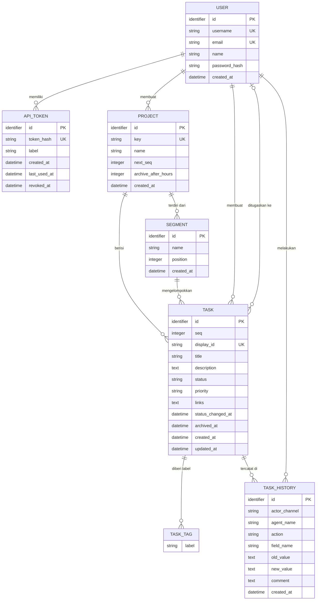
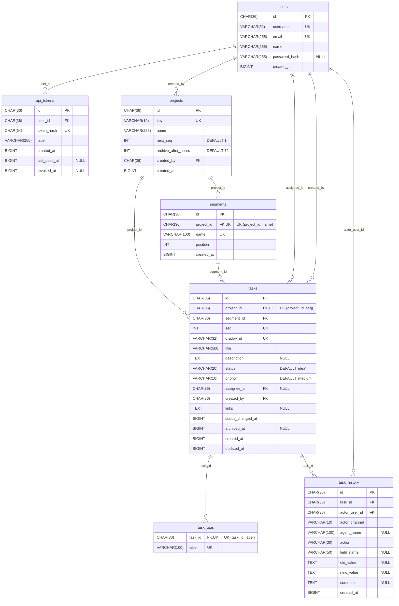

# Desain Database DoTo

Dokumen ini berisi desain data DoTo dalam dua tingkat: **CDM** (Conceptual Data Model) dan **PDM** (Physical Data Model). Sumber kebenarannya tetap [`backend/database/schema.sql`](../backend/database/schema.sql); kalau skema berubah, perbarui juga dokumen ini.

Konvensi umum:

- Semua ID berupa UUID v4 yang disimpan sebagai `CHAR(36)`.
- Semua timestamp berupa milidetik sejak epoch yang disimpan sebagai `BIGINT`.
- DBMS: MySQL/MariaDB, engine InnoDB, charset `utf8mb4`.
- Versi PostgreSQL (tidak dipakai aplikasi, untuk tugas basis data) ada di [`backend/database/schema-postgres.sql`](../backend/database/schema-postgres.sql), lengkap dengan view, function/procedure, dan data dummy.

## CDM (Conceptual Data Model)

CDM menggambarkan entitas, atribut, dan hubungan antarentitas tanpa detail implementasi (tanpa foreign key dan tipe data fisik).



Versi gambar: [PNG](img/cdm.png) · [SVG](img/cdm.svg)

| Entitas | Keterangan |
|---|---|
| USER | Pengguna DoTo. Login web memakai username/email + password. |
| API_TOKEN | Token untuk akses lewat CLI dan MCP server. Satu user bisa punya banyak token; token bisa dicabut (`revoked_at`). |
| PROJECT | Proyek dengan kode unik (mis. `WEB`). `next_seq` dipakai untuk membuat nomor tugas berikutnya. |
| SEGMENT | Kolom board di dalam proyek. Nama segment unik per proyek. |
| TASK | Tugas dengan ID tampilan `KEY-n` (mis. `WEB-1`), status, prioritas, assignee opsional. |
| TASK_TAG | Label/tag pada tugas. Entitas lemah: hanya ada sebagai bagian dari TASK. |
| TASK_HISTORY | Riwayat perubahan dan komentar pada tugas, termasuk dari mana perubahan datang (web, CLI, atau agent AI). |

Kardinalitas:

| Relasi | Kardinalitas | Keterangan |
|---|---|---|
| USER memiliki API_TOKEN | 1 : 0..N | |
| USER membuat PROJECT | 1 : 0..N | |
| PROJECT terdiri dari SEGMENT | 1 : 0..N | |
| PROJECT berisi TASK | 1 : 0..N | |
| SEGMENT mengelompokkan TASK | 1 : 0..N | Setiap tugas wajib berada di satu segment. |
| USER membuat TASK | 1 : 0..N | Pembuat tugas wajib ada. |
| USER ditugaskan ke TASK | 0..1 : 0..N | Tugas boleh belum punya assignee. |
| TASK diberi label TASK_TAG | 1 : 0..N | Label unik per tugas. |
| TASK tercatat di TASK_HISTORY | 1 : 0..N | |
| USER melakukan TASK_HISTORY | 1 : 0..N | User pemilik sesi/token yang melakukan aksi. |

## PDM (Physical Data Model)

PDM menggambarkan tabel fisik sesuai `schema.sql`, lengkap dengan tipe data, primary key, foreign key, dan unique key.



Versi gambar: [PNG](img/pdm.png) · [SVG](img/pdm.svg)

Kolom tanpa keterangan `NULL` bersifat `NOT NULL`.

### Constraint dan index

| Tabel | Nama | Jenis | Kolom | Referensi |
|---|---|---|---|---|
| users | `users_username_unique` | UNIQUE | `username` | |
| users | `users_email_unique` | UNIQUE | `email` | |
| api_tokens | `api_tokens_token_hash_unique` | UNIQUE | `token_hash` | |
| api_tokens | `api_tokens_user_idx` | INDEX | `user_id` | |
| api_tokens | `api_tokens_user_fk` | FK | `user_id` | `users(id)` |
| projects | `projects_key_unique` | UNIQUE | `key` | |
| projects | `projects_created_by_fk` | FK | `created_by` | `users(id)` |
| segments | `segments_project_id_name_unique` | UNIQUE | `project_id, name` | |
| segments | `segments_project_fk` | FK | `project_id` | `projects(id)` |
| tasks | `tasks_display_id_unique` | UNIQUE | `display_id` | |
| tasks | `tasks_project_id_seq_unique` | UNIQUE | `project_id, seq` | |
| tasks | `tasks_board_idx` | INDEX | `project_id, segment_id, status` | |
| tasks | `tasks_project_fk` | FK | `project_id` | `projects(id)` |
| tasks | `tasks_segment_fk` | FK | `segment_id` | `segments(id)` |
| tasks | `tasks_assignee_fk` | FK | `assignee_id` | `users(id)` |
| tasks | `tasks_created_by_fk` | FK | `created_by` | `users(id)` |
| task_tags | `task_tags_task_id_label_unique` | UNIQUE | `task_id, label` | |
| task_tags | `task_tags_task_fk` | FK | `task_id` | `tasks(id)` |
| task_history | `task_history_task_idx` | INDEX | `task_id, created_at` | |
| task_history | `task_history_task_fk` | FK | `task_id` | `tasks(id)` |
| task_history | `task_history_actor_fk` | FK | `actor_user_id` | `users(id)` |

Catatan:

- `task_tags` tidak punya primary key; keunikan baris dijamin oleh unique key `(task_id, label)`.
- Semua foreign key memakai aksi default (`RESTRICT`), jadi baris induk tidak bisa dihapus selama masih direferensikan.
- `tasks.project_id` sebenarnya bisa diturunkan dari `segments.project_id`, tetapi disimpan langsung di `tasks` (denormalisasi) dan dipakai oleh unique key `(project_id, seq)` serta index board.

### Nilai enum

Beberapa kolom `VARCHAR` hanya menerima nilai tertentu. Validasinya dilakukan di aplikasi ([`backend/src/Support/Enums.php`](../backend/src/Support/Enums.php)), bukan di database.

| Kolom | Nilai yang valid | Default |
|---|---|---|
| `tasks.status` | `idea`, `todo`, `in_progress`, `needs_review`, `done` | `idea` |
| `tasks.priority` | `low`, `medium`, `high`, `urgent` | `medium` |
| `task_history.actor_channel` | `web`, `cli`, `agent` | |
| `task_history.action` | `created`, `status_changed`, `priority_changed`, `assignee_changed`, `segment_changed`, `field_updated`, `comment`, `archived` | |

## View

View didefinisikan di bagian akhir `schema.sql` dengan `CREATE OR REPLACE VIEW`, jadi ikut dibuat ulang setiap kali `migrate.php` dijalankan.

| View | Sumber | Kolom tambahan | Dipakai aplikasi |
|---|---|---|---|
| `v_task_detail` | `tasks` ⨝ `projects`, `segments`, `users` (pembuat), ⟕ `users` (assignee) | `project_key`, `project_name`, `segment_name`, `assignee_email`, `assignee_name`, `assignee_username`, `creator_username` | Ya: semua query baca di `TaskRepository` (detail, board, search) |
| `v_task_history_detail` | `task_history` ⨝ `tasks`, `users` (pelaku) | `task_display_id`, `actor_username`, `actor_name` | Ya: `TaskHistoryRepository::findByTaskId` dan komentar baru |
| `v_project_summary` | `projects` ⟕ `tasks`, dikelompokkan per proyek | `segment_count`, `total_tasks`, `idea_count`, `todo_count`, `in_progress_count`, `needs_review_count`, `done_count`, `archived_count` | Tidak, untuk laporan/rekap |
| `v_user_workload` | `users` ⟕ `tasks` aktif (belum `done`, belum diarsipkan) | `active_tasks`, jumlah per status, `high_priority_count` (`high` + `urgent`) | Tidak, untuk laporan/rekap |

Catatan:

- `v_task_detail` dan `v_task_history_detail` sengaja tidak memakai agregat atau subquery, supaya MySQL/MariaDB bisa melebur (MERGE) view ke query pemanggil dan index tabel asli tetap dipakai. Karena itu tag tidak ikut di view; tag tetap diambil dari `task_tags`.
- Penulisan data (`INSERT`/`UPDATE`) tetap langsung ke tabel, bukan lewat view.
- Kolom hitungan di `v_project_summary` dan `v_user_workload` hanya menghitung tugas yang belum diarsipkan, kecuali `total_tasks` dan `archived_count`.

Contoh pemakaian:

```sql
SELECT display_id, title, status, segment_name, assignee_username
FROM v_task_detail
WHERE project_key = 'WEB' AND archived_at IS NULL;

SELECT * FROM v_project_summary;
SELECT * FROM v_user_workload ORDER BY active_tasks DESC;
```
