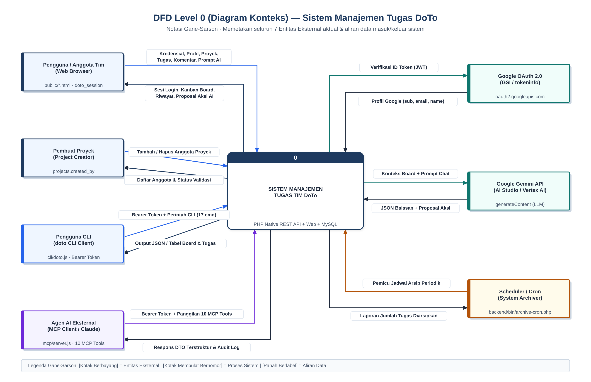
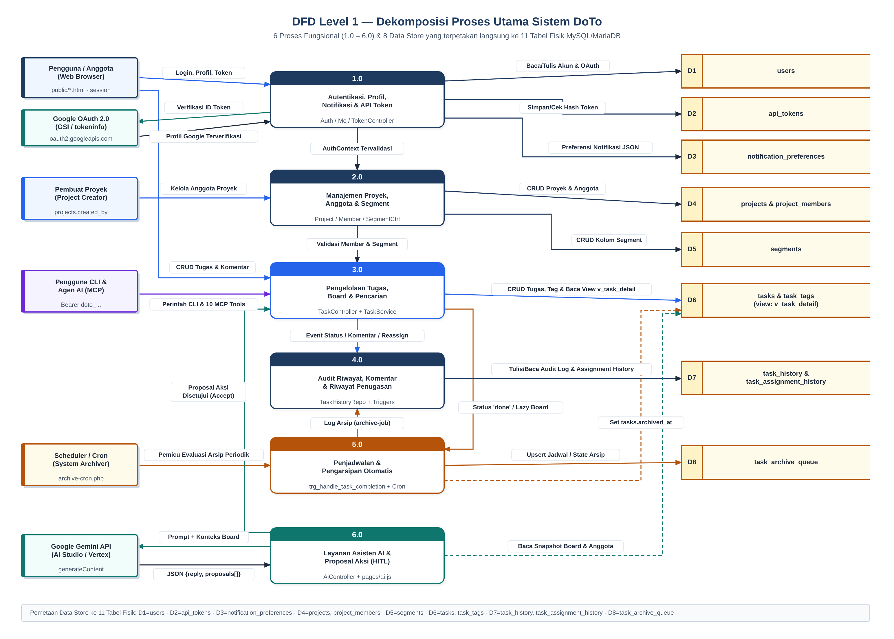
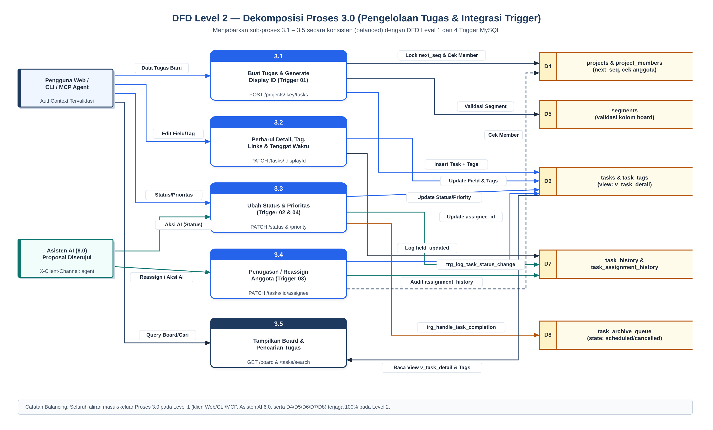
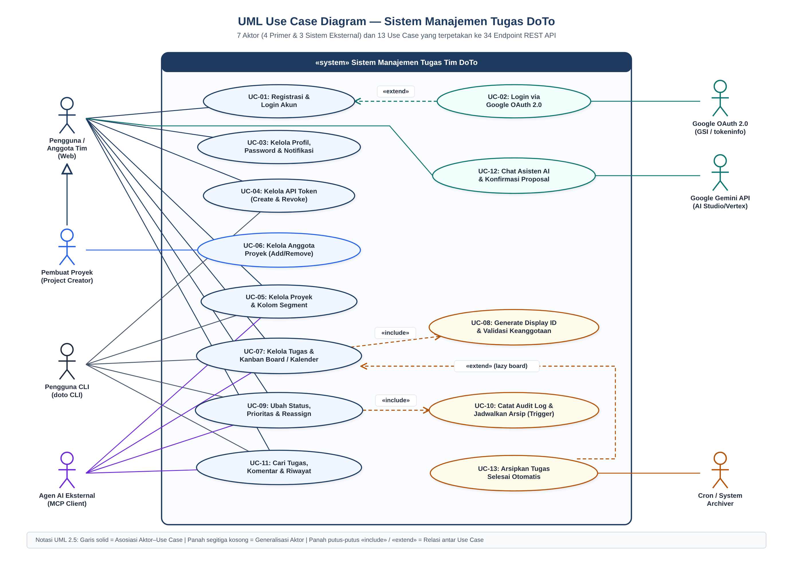
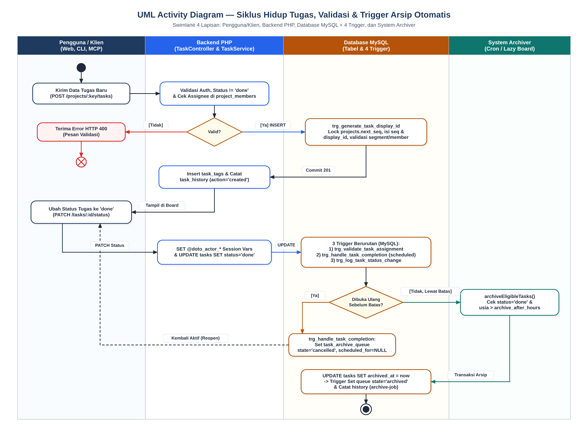
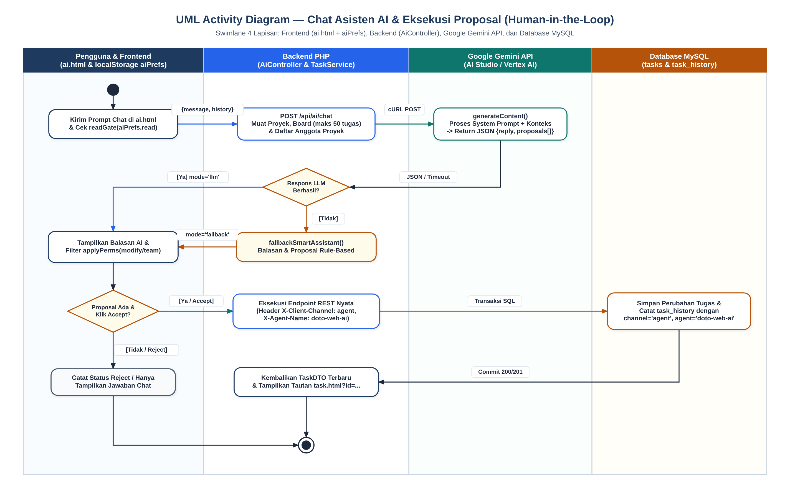
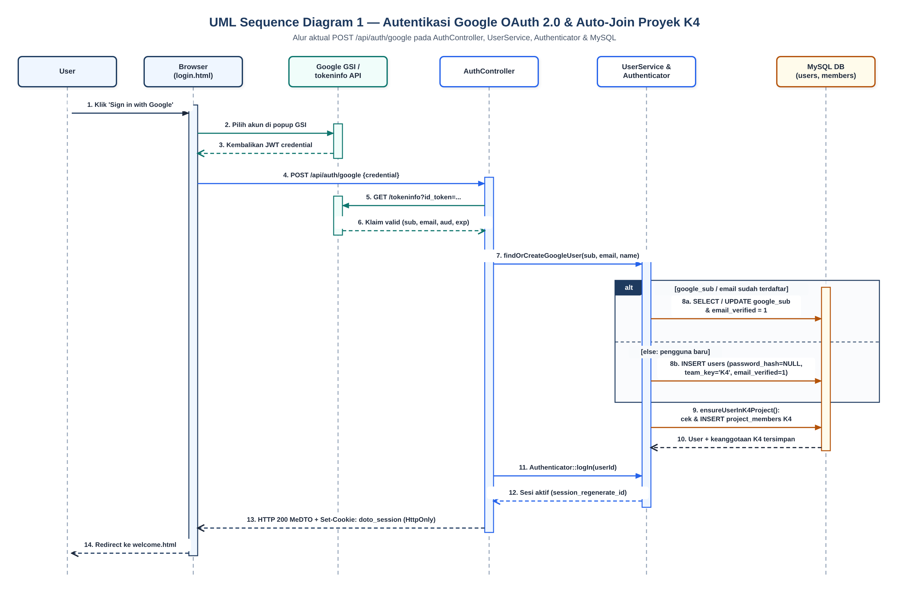
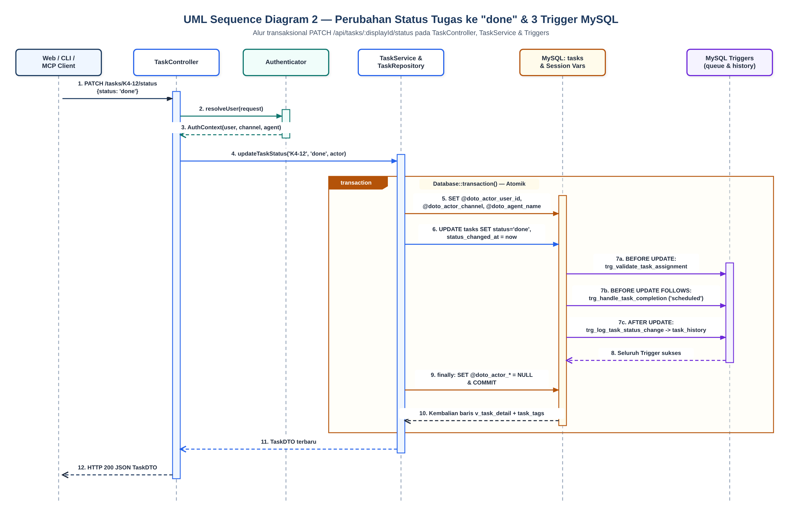
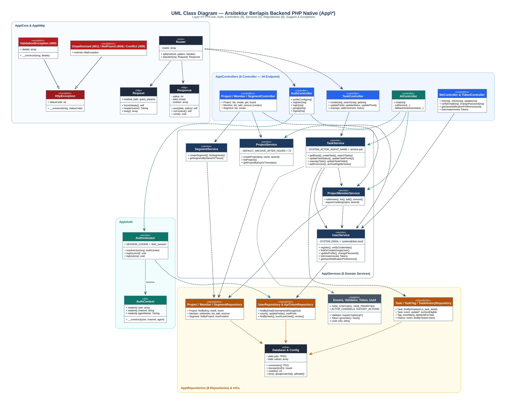

# Desain Sistem DoTo (DFD & UML)

Dokumen ini melengkapi [`docs/database.md`](database.md) dengan pemodelan proses, interaksi aktor, perilaku alur kerja, dan struktur class backend **DoTo** (PHP >= 8.1 native + MySQL/MariaDB InnoDB + HTML/CSS/JS native + Node.js CLI & MCP Server). Seluruh diagram bersumber langsung dari kode produksi aktual (`backend/routes.php`, `backend/src/`, `backend/database/`, `public/`, `cli/doto.js`, dan `mcp/server.js`).

---

## 1. Data Flow Diagram (DFD)

Pemodelan aliran data memakai notasi **Gane-Sarson** secara bertingkat dan konsisten (*balanced*) dari Level 0 hingga Level 2.

### 1.1 DFD Level 0 (Diagram Konteks)

Entitas eksternal yang berinteraksi langsung dengan sistem:

| No | Entitas Eksternal | Jenis | Kanal / Integrasi | Aliran Masuk Utama | Aliran Keluar Utama |
|---|---|---|---|---|---|
| 1 | Pengguna / Anggota Tim | Primer (Manusia) | Web (`public/*.html`, cookie `doto_session`) | Kredensial, profil, preferensi notifikasi, data proyek/tugas, komentar, prompt AI | Sesi login, Kanban Board, kalender, riwayat audit, proposal aksi AI |
| 2 | Pembuat Proyek (`created_by`) | Primer (Manusia) | Web / API | Permintaan tambah & hapus anggota proyek | Daftar anggota & status validasi otorisasi |
| 3 | Pengguna CLI (`doto`) | Primer (Manusia) | `cli/doto.js` (`Bearer doto_...`) | 17 perintah terminal (proyek, segment, board, tugas, token) | Output JSON / tampilan board, detail & riwayat tugas |
| 4 | Agen AI Eksternal (MCP) | Primer (Sistem) | `mcp/server.js` (10 MCP Tools) | Panggilan tool + Bearer token + `X-Agent-Name` | DTO terstruktur proyek, board, tugas, & riwayat |
| 5 | Google OAuth 2.0 (GSI) | Sistem Eksternal | `oauth2.googleapis.com/tokeninfo` | Permintaan verifikasi JWT `id_token` | Klaim identitas terverifikasi (`sub`, `email`, `name`) |
| 6 | Google Gemini API | Sistem Eksternal | AI Studio / Vertex AI `generateContent` | Konteks board, daftar anggota, & histori percakapan | Respons JSON terstruktur (`reply` & `proposals[]`) |
| 7 | Scheduler / Cron Archiver | Timer / Sistem | `backend/bin/archive-cron.php` | Pemicu evaluasi arsip periodik | Laporan jumlah tugas selesai yang diarsipkan |

### 1.2 DFD Level 1 (Dekomposisi 6 Proses Utama)

| Kode Proses | Nama Proses | Modul Aktual | Data Store Terkait |
|---|---|---|---|
| `1.0` | Autentikasi, Profil, Notifikasi & API Token | `AuthController`, `MeController`, `TokenController`, `Authenticator`, `UserService` | `D1 users`, `D2 api_tokens`, `D3 notification_preferences` |
| `2.0` | Manajemen Proyek, Anggota & Segment | `ProjectController`, `ProjectMemberController`, `SegmentController`, `ProjectService`, `ProjectMemberService`, `SegmentService` | `D4 projects & project_members`, `D5 segments` |
| `3.0` | Pengelolaan Tugas, Board & Pencarian | `TaskController`, `TaskService`, `TaskRepository`, `TaskTagRepository` | `D4`, `D5`, `D6 tasks & task_tags` |
| `4.0` | Audit Riwayat, Komentar & Penugasan | `TaskHistoryRepository`, `trg_log_task_status_change`, `trg_validate_task_assignment` | `D7 task_history & task_assignment_history` |
| `5.0` | Penjadwalan & Pengarsipan Otomatis | `trg_handle_task_completion`, `TaskService::archiveEligibleTasks`, `archive-cron.php` | `D6 tasks`, `D7 task_history`, `D8 task_archive_queue` |
| `6.0` | Layanan Asisten AI & Proposal Aksi | `AiController`, `public/assets/js/pages/ai.js` | Membaca `D4`, `D5`, `D6` (eksekusi lewat proses `3.0` setelah konfirmasi pengguna) |

### 1.3 DFD Level 2 — Proses 3.0 (Pengelolaan Tugas & Integrasi Trigger)

---

## 2. Unified Modeling Language (UML)

### 2.1 Use Case Diagram

Ringkasan 13 Use Case utama yang terpetakan ke 34 endpoint REST API (`backend/routes.php`):

| Kode | Nama Use Case | Aktor Terkait | Endpoint Aktual |
|---|---|---|---|
| `UC-01` | Registrasi & Login Akun | Pengguna | `POST /api/auth/register`, `POST /api/auth/login`, `POST /api/auth/logout` |
| `UC-02` | Login via Google OAuth 2.0 (`<<extend>> UC-01`) | Pengguna, Google OAuth 2.0 | `GET /api/config/public`, `POST /api/auth/google` |
| `UC-03` | Kelola Profil, Password & Notifikasi | Pengguna | `GET/PATCH /api/me`, `GET /api/users/check`, `POST /api/me/email/verify`, `POST /api/me/password`, `GET/PUT /api/me/notification-preferences` |
| `UC-04` | Kelola API Token | Pengguna, Pengguna CLI | `GET/POST /api/me/tokens`, `DELETE /api/tokens/:id` |
| `UC-05` | Kelola Proyek & Segment | Pengguna, CLI, MCP | `GET/POST /api/projects`, `GET /api/projects/:key`, `GET/POST /api/projects/:key/segments` |
| `UC-06` | Kelola Anggota Proyek | Pembuat Proyek (`created_by`) | `GET/POST /api/projects/:key/members`, `DELETE /api/projects/:key/members/:userId` |
| `UC-07` | Kelola Tugas & Kanban Board / Kalender | Pengguna, CLI, MCP | `GET /api/projects/:key/board`, `POST /api/projects/:key/tasks`, `GET/PATCH /api/tasks/:displayId` |
| `UC-08` | Generate Display ID & Validasi Keanggotaan (`<<include>> UC-07`) | Sistem / DB Trigger | `trg_generate_task_display_id`, `ProjectMemberService::isMember` |
| `UC-09` | Ubah Status, Prioritas & Reassign | Pengguna, CLI, MCP | `PATCH /api/tasks/:displayId/{status,priority,assignee}` |
| `UC-10` | Catat Audit Log & Jadwalkan Arsip (`<<include>> UC-09`) | Sistem / DB Triggers | `trg_validate_task_assignment`, `trg_handle_task_completion`, `trg_log_task_status_change` |
| `UC-11` | Cari Tugas, Tambah Komentar & Lihat Riwayat | Pengguna, CLI, MCP | `GET /api/tasks/search`, `POST /api/tasks/:displayId/comments`, `GET /api/tasks/:displayId/history` |
| `UC-12` | Chat Asisten AI & Konfirmasi Proposal | Pengguna, Google Gemini API | `POST /api/ai/chat` + eksekusi aksi melalui endpoint `UC-07`/`UC-09`/`UC-11` |
| `UC-13` | Arsipkan Tugas Selesai Otomatis | Cron Archiver (dan lazy `GET /board`) | `TaskService::archiveEligibleTasks()` (`backend/bin/archive-cron.php`) |

### 2.2 Activity Diagram 1 — Siklus Hidup Tugas & Trigger Arsip Otomatis

### 2.3 Activity Diagram 2 — Chat Asisten AI (Human-in-the-Loop)

### 2.4 Sequence Diagram 1 — Autentikasi Google OAuth 2.0 & Auto-Join K4

### 2.5 Sequence Diagram 2 — Perubahan Status Tugas ke `done` & 3 Trigger MySQL

### 2.6 Class Diagram — Arsitektur Berlapis Backend PHP Native (`App\*`)

